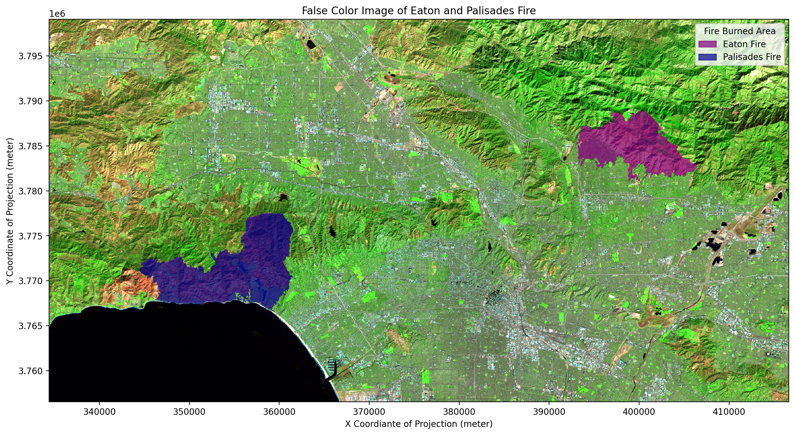

# Mapping the 2025 Eaton and Palisades Fire Scars with Landsat 8 False Color Imagery



## About

In January 2025, the Eaton and Palisades fires, driven by strong and dry Santa Ana winds, burned large areas of Los Angeles County. This repository contains an analysis for EDS 220 (Homework 4, Task 2) that uses Landsat 8 imagery to show where the two fires burned.

The analysis:

- Explores the CAL FIRE perimeter shapefiles for both fires (CRS, geometry types, extent)
- Imports Landsat 8 surface reflectance data from NetCDF and restores its geospatial information (CRS) with `rioxarray`
- Builds a true color composite (red, green, blue) and a false color composite (SWIR, NIR, red)
- Reprojects the fire perimeters to the raster's CRS and overlays them on the false color image

In the false color composite, healthy vegetation shows up green and burned areas show up red/orange, so the fire scars are easy to see.

## Repository Structure

```
eds220-hwk4
├── README.md
├── .gitignore
├── hwk4-task2-false-color-FU.ipynb      # Main analysis notebook
├── hwk4-task2-false-color-FU.html       # Rendered HTML version of the notebook
├── hwk4-task2-false-color-FU_files/     # Figures and assets for the HTML render
└── data/                                # NOT tracked by git (see Data Access)
    ├── Eaton_Perimeter_20250121/
    │   └── Eaton_Perimeter_20250121.shp (+ .dbf, .shx, .prj, .cpg, .xml)
    ├── Palisades_Perimieter_20250121/
    │   └── Palisades_Perimieter_20250121.shp (+ .dbf, .shx, .prj, .cpg, .xml)
    └── landsat8-2025-02-23-palisades-eaton.nc
```

## Data Access

The `data/` folder is listed in `.gitignore` and is **not** included in this repository. To run the notebook, create a `data/` folder in the repository root and add the files exactly as shown in the structure above.

- **Fire perimeters:** Download the Eaton and Palisades perimeter shapefiles from the [LA County eGIS Hub](https://egis-lacounty.hub.arcgis.com/maps/ad51845ea5fb4eb483bc2a7c38b2370c/about). The county publishes these layers, and CAL FIRE is the source of the data. I accessed them on November 18, 2026.
- **Landsat 8:** `landsat8-2025-02-23-palisades-eaton.nc` is a Landsat 8 Collection 2 Level-2 scene from February 23, 2025, clipped to the fire area. It contains the red, green, blue, NIR (`nir08`), and SWIR (`swir22`) bands at 30 m resolution in EPSG:32611. It was provided through the EDS 220 course. The original data comes from the USGS (see References).

## Getting Started

1. Clone the repository:
   ```bash
   git clone https://github.com/cuvlin/eds220-hwk4.git
   ```
2. Add the data files as described in [Data Access](#data-access).
3. Install the Python dependencies:
   `geopandas`, `xarray`, `rioxarray`, `matplotlib`, `numpy`, `pandas`
4. Open and run `hwk4-task2-false-color-FU.ipynb`, or view the rendered `hwk4-task2-false-color-FU.html` without running anything.

## Author

[Calvin Fu](https://github.com/cuvlin), Master of Environmental Data Science (MEDS), UC Santa Barbara

## References

### Data

Los Angeles County Enterprise GIS. (2025). *Palisades and Eaton dissolved fire perimeters (2025)* [Data set]. County of Los Angeles. Retrieved November 18, 2026, from https://egis-lacounty.hub.arcgis.com/maps/ad51845ea5fb4eb483bc2a7c38b2370c/about

U.S. Geological Survey. (2021). *Landsat 8-9 Operational Land Imager / Thermal Infrared Sensor Level-2, Collection 2* [Data set]. U.S. Geological Survey. https://doi.org/10.5066/P9OGBGM6

### Acknowledgements

This analysis was completed as part of EDS 220: Working with Environmental Datasets in the Master of Environmental Data Science program at the Bren School of Environmental Science & Management, UC Santa Barbara. Thanks to the EDS 220 teaching team for the assignment and the pre-processed Landsat data.
